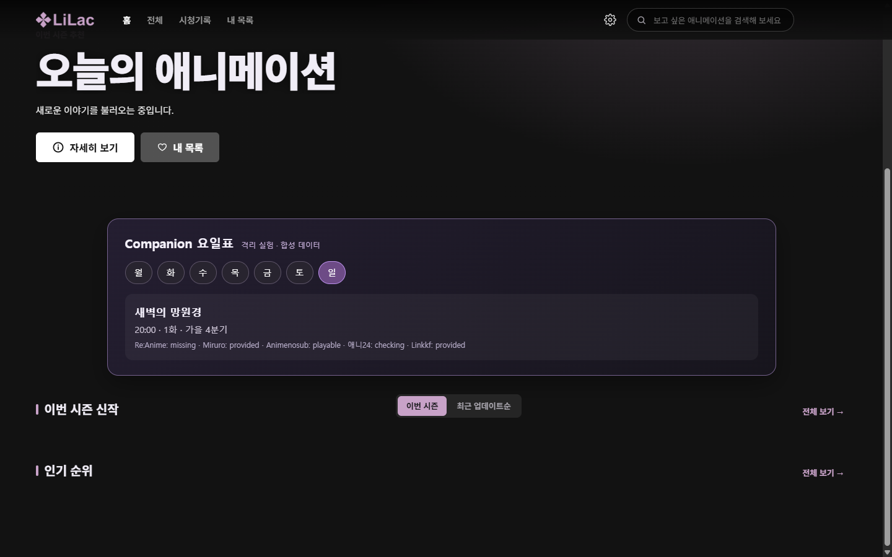

# LilacAnime v0.5.14 런타임 화면 연결 실증

기준 브랜치 `codex/runtime-companion-prototype`, 기준 커밋 `dcd6b9818c0f13fd9970cc3c94e4539fd33aeb64`에서 진행했다. 원본 v0.5.14는 `dinoforge/anime-player` 커밋 `f095fc3d775451e144ed780e1fa081f739927652`의 Git 아카이브로 격리해 시험했다.

## 먼저 답

| 질문 | 실증 결과 |
| --- | --- |
| 원본 화면에 실제 Companion UI가 나타났나? | **예.** 독립 모형이 아니라 격리된 v0.5.14 앱의 실제 `src/index.html` 렌더러 안, `#homeView`의 `#scheduleSection` 앞에 요일표를 삽입했다. 캡처와 DOM 로그를 남겼다. |
| 실행 중 연결 방식은? | 임시 테스트 사본의 main process가 해당 창의 `webContents.debugger`에 CDP 1.3으로 붙었다. 외부 디버깅 포트는 열지 않았다. 별도 테스트 자식 프로세스가 Companion 카탈로그의 합성 일정을 표준 입출력으로 전달했다. |
| 원본 파일·프로필을 수정하지 않았나? | **설치본과 기존 프로필은 접근하지 않았다.** 공식 v0.5.14 Git 아카이브의 사본에서만 `electron/main.cjs`에 시험용 연결 고리를 임시 추가했다. `src/index.html`과 preload는 사본에서도 해시가 그대로였다. 빈 임시 프로필을 만들고 앱이 생성한 파일을 해시한 뒤 테스트 트리 전체를 정리했다. |
| Companion 종료 후 추가 UI가 사라졌나? | **예.** 테스트 Companion 자식 프로세스가 정상 종료한 뒤, 디버거가 아직 붙어 있는 동안 DOM 영역을 제거했다. 원본 DOM 노드가 유지된 것을 확인한 다음 디버거를 분리했다. 그 후 원본 검색 이동, 상세 다이얼로그 열기·닫기, 설정 이동을 확인했고 원본 창도 살아 있었다. |
| 원본 업데이트 때 제약은? | 현재 접점은 v0.5.14의 `#homeView`, `#scheduleSection`, 원본 `window.lilac` preload 브리지와 DOM 구조에 묶인다. 다음 버전은 버전과 DOM 지문을 다시 검사하고, 불일치하면 삽입하지 않아야 한다. |
| 실사용 버전에 바로 도입해도 안전한가? | **아니다.** 이 결과는 테스트 사본에 main-process 연결 고리를 넣었을 때의 가능성을 증명한다. 수정하지 않은 설치본에 독립 Companion이 직접 붙는 공개 API는 확인하지 못했다. 제품화에는 upstream의 명시적 브리지/API 또는 허용된 호스트 어댑터가 필요하다. |

## 실제로 확인한 범위

Electron 공식 문서에서 `webContents.debugger`가 main-process `WebContents`에 제공되며 `attach`, CDP 명령 전송, `detach`를 지원하는 점을 확인했다. 이 방법을 테스트 앱 내부에서만 사용했다. [`webContents` 문서](https://www.electronjs.org/docs/latest/api/web-contents), [`Debugger` API 문서](https://www.electronjs.org/docs/latest/api/debugger).

재현 명령은 다음과 같다. `--run` 없이는 앱을 띄우지 않는다.

```powershell
node tests/runtime-attach-feasibility.cjs --run
```

실행기는 현재 브랜치와 기준 커밋, 원본 패키지 버전, 기존 로컬 Electron 런타임을 확인한다. 공식 소스를 시스템 임시 폴더에 풀고, 고유 앱 ID와 `userData`, `sessionData`, cache, 로그, crash dump 경로를 그 폴더 아래에만 지정했다. 의존성은 기존 프로젝트 `node_modules` 접합점을 사용했으며 설치나 빌드는 하지 않았다.

네트워크 시험은 격리 사본 안에서 막았다. main-process `fetch`·Electron `net`·Node HTTP 요청은 거부했고, Chromium의 HTTP(S)/WebSocket/FTP 요청도 세션 단계에서 취소하도록 설정했다. DNS 조회 차단 스위치도 켰다. 기록상 main-process 요청 9건은 차단됐고 렌더러의 외부 요청은 0건이었다. 디버거에 TCP 포트를 할당하거나 공개하지 않았다.

시험용 고리만 있는 사본에서 원본 렌더러가 `file:`의 `src/index.html`인지, 문서 제목이 `LilacAnime`인지, 홈·검색·설정·상세 다이얼로그 노드와 `window.lilac`가 있는지 확인했다. 첫 실행 changelog는 임시 프로필에서 원본 확인 버튼으로 닫았다. 그 뒤 `companion/core/catalog.cjs`를 불러오는 별도 Node 자식이 합성 주간 데이터 7개와 출처 상태 5개를 전달했다. 렌더러 DOM API와 `textContent`로 월~일 버튼을 만들고 7개 버튼을 각각 눌러 선택 작품이 바뀌는 것을 확인했다.

최종 재실행에서 요일표는 1440×900 렌더러 뷰포트의 `(x=173, y=353)`에 1080×253 크기로 표시됐고, 실행 중 changelog 대화상자가 남아 있지 않은 것도 확인했다. 월~일 탭을 각각 눌렀을 때 합성 작품이 선택된 값으로 바뀌었다.



최종 실행 로그에는 단계별 실행 결과, 원본 사본의 해시, 임시 프로필에서 생성된 47개 파일의 이름·SHA-256, UI 제거 전 디버거 상태, 외부 요청 차단 횟수, 종료 후 정리 결과가 기록돼 있다: [runtime-attach-evidence-20261010T181208Z.jsonl](runtime-attach-evidence-20261010T181208Z.jsonl). 앞선 실행의 화면 캡처와 로그도 별도 보존돼 있다.

## 결과 구분

- **A — UI 삽입 성공:** 예. 실제 원본 v0.5.14 renderer에서 확인했다.
- **B — UI만 삽입되고 Companion 데이터는 연결되지 않음:** 해당하지 않는다. 합성 데이터는 `companion/core/catalog.cjs`에서 만들어 별도 자식 프로세스의 stdio로 시험용 호스트에 전달했고 UI에 표시됐다. 단, 전체 Companion Electron 창 자체를 실행한 시험은 아니다.
- **C — 데이터는 연결됐지만 재생 제어 불가:** 재생 제어는 호출하거나 시험하지 않았다. 따라서 가능·불가능 어느 쪽도 판정하지 않는다.
- **D — 보안 또는 기술 제약으로 연결 불가:** 격리 사본의 in-process CDP 경로에서는 해당하지 않는다. 다만 수정되지 않은 설치본에 외부 Companion을 연결하는 지원 API는 확인되지 않아 제품 수준 연동은 아직 미검증이다.

시험 고리는 `electron/main.cjs`의 `createWindow()`에서 원본 창의 `webContents`를 받아 동작했다. 따라서 외부 Companion 프로세스만으로 원본 `WebContents`를 얻은 실험은 아니다. 별도 Companion 창을 원본처럼 그려 놓고 성공으로 오판하지 않도록, 테스트 자식은 데이터 공급만 하고 실제 DOM 삽입·캡처는 원본 창의 `webContents`에 대해 수행했다.

원본 UI 회귀 확인은 기존 검색 화면으로 이동하고 입력 요소가 존재하는지, 설정 화면으로 이동하는지, 상세 다이얼로그를 열고 닫을 수 있는지 확인하는 구조 수준 검사다. 네트워크를 차단했기 때문에 실제 검색어 조회, 공급원 검색 결과, 작품 선택에 따른 상세 정보 표시까지는 실행하지 않았다. 이 범위를 실제 검색 기능의 성공으로 해석하지 않는다.

## 무결성·보안 경계

| 대상 | 시험 전 | 시험 후·정리 |
| --- | --- | --- |
| v0.5.14 임시 사본 `electron/main.cjs` | `2de2597f512c690aed7c3bb156fe2091f2852819bc15236c61c63f7c6e18bbd2` | 시험용 고리가 포함된 동안 `003ff71d2e68b5fc0e0e41492cafb0021d01d393efe96e4bef8799471348d30b`; 임시 트리와 함께 삭제 |
| 임시 사본 `src/index.html` | `061c168f8645cbbe6f7055f1f872c3423a0c3d1eed2fb0b6a9bc7a039f613aff` | 동일 |
| 임시 사본 `electron/preload.cjs` | `ee1f6dfd17b8bc502d939dc8c21c8e452cb93d8f1cc05121aedd145673b374ce` | 동일 |
| `app.asar` | 원본 v0.5.14 소스 아카이브에 없음 | 만들거나 수정하지 않음 |
| 프로필 | 빈 전용 임시 디렉터리 | 앱이 만든 파일 47개를 해시 후 임시 트리 정리 |

공식 v0.5.14 Git 객체와 작업 브랜치의 원본 소스는 변경하지 않았다. `D:\LilacAnime`, 설치 실행 파일, 기존 사용자 프로필, 업데이트 캐시, 기존 감사 파일은 열거나 수정하지 않았다. 화면 캡처는 Computer Use가 아니라 Electron `Page.captureScreenshot`로 실제 앱 `webContents`에서 저장했다.

## 다음 버전 호환성과 후속 연결점

v0.5.14에서 확인한 홈 삽입점은 `#homeView` 안의 `#scheduleSection` 앞이다. 안전한 후속 구현은 앱 main에서 정확한 `app.getVersion()`과 `src/index.html`의 DOM 지문을 먼저 검사하고, **검증된 버전·구조일 때만** 제한된 브리지를 연다. 버전 또는 지문이 다르면 아무 UI도 삽입하지 않고 연결을 해제해야 한다. 앱 업데이트 파일이나 `app.asar`를 패치하는 방식은 사용하지 않는다.

다음 패치에서 재사용할 구체적 코드 접점은 다음과 같다.

- 요일·분기 도메인 로직: `src/quarter-selection.js`, `src/weekday-schedule.js`.
- 주간 데이터 구성과 5개 출처 상태 행: `companion/core/catalog.cjs`의 `buildDemoWeek()`와 `sourceRows()`.
- Companion 일정 IPC: `companion/electron/main.cjs`의 `calendarState()` 및 `companion:calendar-state`; preload 공개 API는 `companion/electron/preload.cjs`의 `calendarState()`.
- 수동 ChatGPT 번역 흐름: `companion/core/subtitle-workflow.cjs`; 제한된 preload 메서드는 `makePrompt`, `applyResponse`, `copyText`, `openChatGPT`, `exportSubtitle`이다. API 자동 호출이 아니라 사용자가 복사·붙여넣기 하는 흐름을 유지해야 한다.
- 원본 화면에는 독립 Companion 창을 추가하지 말고 확인된 홈 앵커에 UI를 소유하도록 한다. 실제 공급원 요청과 재생 제어는 이번 시험에서 추가하지 않았다.

프로덕션 적용 전제는 원본 main에서 명시적으로 지원하는 host bridge 또는 upstream 확장 API다. 이 전제가 없으면 격리된 시험 결과를 근거로 기존 설치본에 원격 디버깅 포트를 열거나 자동 삽입하지 않는다.

## 최신 재현 실행

- `node tests/runtime-attach-feasibility.cjs --run`: 통과. v0.5.14 소스 사본 main에 시험용 hook 하나만 넣고 실제 원본 renderer의 `#homeView`에서 실행했다.
- 삽입 UI의 `getBoundingClientRect()`가 화면 안의 1080×253 영역을 반환했고, changelog 모달이 닫힌 상태임을 검사한 뒤 PNG를 캡처했다.
- Companion 자식 프로세스가 정상 종료한 뒤 DOM 요소를 먼저 제거했다. 이때 `webContents.debugger.isAttached() === true`임을 로그로 확인하고, 그다음 CDP 연결을 닫았다.
- `npm test`: 296/296 통과. `node --check` 3개 파일과 `git diff --cached --check` 통과.
- 최신 재현 실행 시각은 로그의 `2026-10-10T18:12:08Z`이며, 화면 증거는 `assets/runtime-attach-v0.5.14-20261010T181208Z.png`다.
- 실행기는 기준 커밋 `dcd6b981`에서 파생된 새 브랜치 커밋에서도 재실행 가능하도록 `git merge-base` 조상 관계를 확인한다. 로그와 화면 캡처가 이미 있어도 자체 증거 파일명 규칙에 해당하면 실행을 허용한다.
